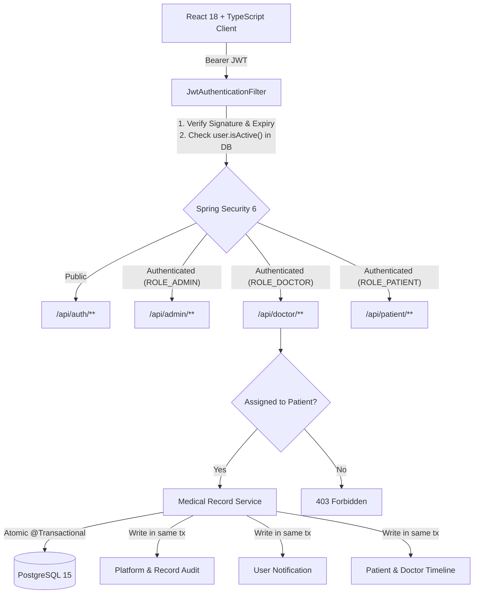
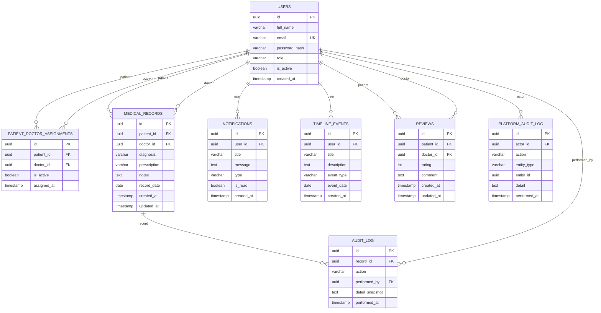

# MedVault

MedVault is a secure, role-based medical-record management system that enables patients to securely view their clinical records, doctors to manage records for their assigned patients, and administrators to oversee doctor approvals and patient assignments.

MedVault is **not** an appointment platform, hospital ERP, billing engine, or telemedicine system. Those capabilities are explicitly excluded from the V1 scope.

---

## 1. Core Capabilities & Architecture

| Capability | Description |
| --- | --- |
| **Strict Role Separation** | Dedicated portals and permission boundaries for Admin, Doctor, and Patient roles. |
| **Doctor Approval Workflow** | Newly registered doctors are created in an inactive, pending state without a JWT until vetted and approved by an administrator. |
| **Controlled Care Assignment** | Doctors can only access patients explicitly assigned to them by an administrator. A patient can have at most one active doctor at any time (enforced at both service and database levels). |
| **Transactional Business Events** | Clinical record changes, doctor approvals, and patient assignments atomically write audit logs, notifications, and timeline events in a single transaction. |
| **Real-time Deactivation Invalidation** | JWT validation re-verifies user active status directly from the database on every authenticated request, immediately revoking access upon account deactivation. |
| **Platform & Clinical Auditing** | Administrators have visibility into platform-level domain events (registrations, approvals, assignments) and record-level clinical audit trails. |



---

## 2. Technology Stack

- **Backend:** Java 21, Spring Boot 3.2.5 (Spring Web, Spring Security, Spring Data JPA, Bean Validation), JJWT 0.11.5, Bucket4j rate-limiting
- **Database & Migrations:** PostgreSQL 15, Flyway 10.10.0 (versioned migrations V1-V16)
- **Frontend:** React 18, TypeScript, Vite, Tailwind CSS, TanStack React Query, Lucide Icons
- **Infrastructure:** Docker, Docker Compose, Nginx (frontend container)

---

## 3. Roles & Permissions Matrix

MedVault enforces strict role-based access control (RBAC) at both the HTTP security filter and method level (`@PreAuthorize`):

| Resource / Action | Admin | Doctor | Patient |
| --- | :---: | :---: | :---: |
| Self-Registration | ❌ (Seeded only) | ✅ (Pending approval) | ✅ (Immediate active) |
| Doctor Approval / Rejection | ✅ | ❌ | ❌ |
| Doctor Deactivation | ✅ | ❌ | ❌ |
| View Doctors / Patients List | ✅ | ❌ | ❌ |
| Assign / Reassign / Unassign Patient | ✅ | ❌ | ❌ |
| View Assigned Patients | ❌ | ✅ (Assigned only) | ❌ |
| Read Clinical Records | ✅ (Administrative oversight) | ✅ (Assigned only) | ✅ (Own records only) |
| Create / Update Clinical Records | ❌ | ✅ (Assigned only) | ❌ |
| Submit / Update Doctor Review | ❌ | ❌ | ✅ (Assigned doctor only) |
| Read Doctor Reviews | ❌ | ✅ (Own received reviews) | ❌ |
| View Notifications | ✅ (Own platform notifications) | ✅ (Own notifications) | ✅ (Own notifications) |
| View Timeline Events | ❌ | ✅ (Own activity) | ✅ (Own activity) |
| Platform & Record Audit Logs | ✅ | ❌ | ❌ |
| Profile / Password Management | ✅ (Own profile) | ✅ (Own profile) | ✅ (Own profile) |

---

## 4. Key Workflows

### Doctor Registration & Approval
1. Doctor registers via `POST /api/auth/register` with `role: "ROLE_DOCTOR"`.
2. The account is created with `active = false`. The API returns HTTP 200 with `token = null` and a message stating approval is required.
3. The pending doctor cannot log in: `POST /api/auth/login` returns HTTP 401 with a generic `Invalid email or password` message (unknown email, wrong password, and inactive accounts all return the identical response so account state is not leaked).
4. Administrator reviews pending doctors on `POST /api/admin/doctors/{id}/approve` (or `reject`).
5. Upon approval, the doctor is activated, a `DOCTOR_APPROVED` platform audit log is created, and an in-app notification is sent.
6. The approved doctor can now authenticate and receive a JWT.

### Patient Care Assignment & Reassignment
1. Administrator assigns a patient to an approved doctor via `POST /api/admin/assignments`.
2. Business rule: **A patient can have at most one active doctor assignment**. Attempting to assign an already-assigned patient returns HTTP 409 Conflict. A partial unique index (`idx_assignment_unique_active_patient WHERE is_active = true`) guarantees this at the database level.
3. Upon assignment, `PATIENT_ASSIGNED` audit logs, notifications, and timeline events are generated for both the doctor and patient.
4. When transferring care, administrator calls `PUT /api/admin/assignments/{id}`. The previous assignment is marked inactive (preserving history) and the new active relationship is created. The former doctor immediately loses clinical record access.
5. To end care without reassigning, administrator calls `DELETE /api/admin/assignments/{id}` (`PATIENT_UNASSIGNED`).

### Clinical Records & Atomic Event Triad
1. An assigned doctor creates a medical record via `POST /api/doctor/patients/{patientId}/records`.
2. The service verifies that the doctor is currently actively assigned to the patient (returning HTTP 403 Forbidden otherwise).
3. The operation executes in a single `@Transactional` boundary:
   - Persists the `MedicalRecord`
   - Records an immutable snapshot in `AuditLog`
   - Emits a `MEDICAL_RECORD_CREATED` event to `PlatformAuditLog`
   - Creates a notification for the patient
   - Creates timeline entries for both doctor and patient
4. If any event write fails, the entire transaction rolls back.

### Patient Doctor Reviews
1. A patient can submit feedback for their actively assigned doctor via `POST /api/patient/reviews`.
2. The doctor is resolved server-side from the active assignment—the client cannot supply an arbitrary doctor ID.
3. Enforces **one review per patient-doctor pair** (upsert semantics backed by a database unique index `idx_review_unique_patient_doctor`).
4. The doctor can inspect all received reviews at `GET /api/doctor/reviews`.

---

## 5. API Reference Summary

### Authentication (`/api/auth`)
- `POST /api/auth/register` — Public self-registration (ROLE_PATIENT or ROLE_DOCTOR only).
- `POST /api/auth/login` — Authenticate and receive JWT (active users only).

### Administration (`/api/admin`, paginated `Page<T>` unless noted)
- `GET /api/admin/users` — Paginated list of all registered system accounts.
- `GET /api/admin/doctors` — Paginated list of all doctor accounts.
- `GET /api/admin/patients` — Paginated list of all patient accounts.
- `POST /api/admin/doctors/{id}/approve` — Approve and activate a pending doctor.
- `POST /api/admin/doctors/{id}/reject` — Reject a pending doctor registration.
- `POST /api/admin/doctors/{id}/deactivate` — Deactivate an active doctor account.
- `GET /api/admin/assignments` — Paginated list of active patient-doctor assignments.
- `POST /api/admin/assignments` — Assign patient to doctor.
- `PUT /api/admin/assignments/{id}` — Reassign patient to a different doctor.
- `DELETE /api/admin/assignments/{id}` — Unassign patient.
- `GET /api/admin/audit-logs` — Paginated platform audit trail (`Page<PlatformAuditLogResponse>`).
- `GET /api/admin/records/{recordId}/audit` — Paginated record-level audit history.
- `GET /api/admin/patients/{patientId}/records` — Paginated patient records for oversight.

### Doctor Portal (`/api/doctor`)
- `GET /api/doctor/patients` — List patients actively assigned to the calling doctor.
- `GET /api/doctor/patients/{patientId}/records` — Paginated view of assigned patient's records.
- `POST /api/doctor/patients/{patientId}/records` — Create clinical record for assigned patient.
- `GET /api/doctor/reviews` — Paginated reviews received by the doctor.

### Patient Portal (`/api/patient`)
- `GET /api/patient/records` — Paginated list of patient's own clinical records.
- `GET /api/patient/records/{id}` — Get single record details (ownership verified).
- `GET /api/patient/my-doctor` — Information on actively assigned doctor.
- `POST /api/patient/reviews` — Submit or update rating (1–5) and review for assigned doctor.

### Notifications & Timeline (Shared, paginated `Page<T>`: default 20, max 100)
- `GET /api/doctor/notifications` or `GET /api/patient/notifications` — List own notifications (newest first).
- `PATCH /api/notifications/{id}/read` — Mark own notification as read.
- `GET /api/doctor/timeline` or `GET /api/patient/timeline` — List chronological activity timeline.
- `GET /api/user/profile` / `PATCH /api/user/profile` — View or update own profile name.
- `POST /api/user/change-password` — Change account password.

---

## 6. Database Migrations (Flyway)

MedVault uses sequential Flyway SQL migrations located in `backend/src/main/resources/db/migration`:

- `V1__users.sql`: User accounts table.
- `V2__patient_doctor_assignments.sql`: Patient-doctor assignment table.
- `V3__medical_records.sql`: Clinical records table.
- `V4__audit_log.sql`: Medical-record-specific audit table.
- `V5__indexes.sql`: Foreign key and query optimization indexes.
- `V6__seed_users.sql`: Placeholder — intentionally contains NO user seeds. Development
  credentials must never ship in universal migrations (see `DatabaseSeeder`, active only on
  `local`/`dev` profiles). Note: databases migrated with the old V6/V10/V13 files need
  `flyway repair` or a fresh volume after this fix.
- `V7__add_user_profile_fields.sql`: Profile fields.
- `V8__create_notifications_table.sql`: In-app notification store.
- `V9__create_timeline_events_table.sql`: Timeline event store.
- `V10__create_reviews_table.sql`: Doctor review store (exactly one seed review per
  patient-doctor pair, matching the V13/V15 unique rule).
- `V11__platform_audit_log.sql`: Platform-wide business and security audit store.
- `V12__assignment_isactive_and_unique.sql`: Enforces `is_active` column and partial unique index on active patient assignments.
- `V13__review_unique_patient_doctor.sql`: Dedupes legacy rows, then enforces one review per patient-doctor relationship.
- `V14__remove_ooscope_seed_data.sql`: Removes out-of-scope appointment seed items.
- `V15__deduplicate_reviews_before_unique_constraint.sql`: Safety net — removes any remaining
  duplicate `(patient_id, doctor_id)` reviews and guarantees the unique index exists.
- `V16__remove_ooscope_lab_seed_data.sql`: Removes leftover lab/prescription-themed seeds missed by V14.

---

## 7. Environment Variables & Configuration

Copy `.env.example` to `.env` to configure your environment:

| Variable | Default | Purpose |
| --- | --- | --- |
| `JWT_SECRET` | *(Required — no default; startup fails without it)* | HMAC-SHA256 secret key (minimum 32 characters). Generate with `openssl rand -hex 32`. Never commit the real value. |
| `JWT_EXPIRATION` | `1800000` (30 min) | Token validity duration in milliseconds. |
| `SPRING_DATASOURCE_URL` | `jdbc:postgresql://localhost:5432/medvault` (dev) | PostgreSQL connection URL. Required in prod. |
| `SPRING_DATASOURCE_USERNAME` | `medvault_user` (dev/docker) | Database user. Required in prod. |
| `SPRING_DATASOURCE_PASSWORD` | `medvault_password` (dev/docker) | Database password. Required in prod. |
| `CORS_ALLOWED_ORIGINS` | `http://localhost:3000,http://localhost:5173` | Allowed origins whitelist for CORS (comma-separated). Required in prod. |
| `RATE_LIMIT_TRUST_PROXY` | `false` | Set `true` only behind a trusted proxy that sanitizes `X-Forwarded-For`. |
| `PORT` | `8080` | Backend listening port. |
| `VITE_API_BASE_URL` | `/api` | Base URL used by the frontend client. |

> Production starts with **no default users and no usable default JWT secret**.
> Set `JWT_SECRET` and run migrations on an empty database; create the first admin
> via the `local`/`dev` seeder flow or a controlled bootstrap, then rotate credentials.

---

## 8. Local Setup & Running

### Option A: Docker Compose (Recommended)

1. Ensure Docker is running.
2. Copy environment settings:
   ```bash
   cp .env.example .env
   ```
3. Build and launch all services:
   ```bash
   docker compose up --build -d
   ```
4. Access:
   - Frontend: `http://localhost:3000`
   - Backend API: `http://localhost:8080/api`
   - Health Check: `http://localhost:8080/api/health`

### Option B: Local Development

**1. Backend:**
```bash
cd backend
# Run with in-memory H2 profile (no PostgreSQL required)
./mvnw spring-boot:run -Dspring-boot.run.profiles=local

# Or run with PostgreSQL
./mvnw spring-boot:run
```

**2. Frontend:**
```bash
cd frontend
npm ci
npm run dev
```
Open `http://localhost:5173` in your browser.

---

## 9. Verification & Automated Testing

The backend test suite validates all 26 required V1 security, domain, and integration scenarios:

```bash
cd backend
./mvnw test
```

### Verified Scenarios:
- [x] Patient registration and immediate token issuance
- [x] Doctor registration with null token & pending approval restriction
- [x] Account-inactive login prevention (uniform 401, no state oracle)
- [x] Uniform login failures: unknown email, inactive account, and wrong password are indistinguishable
- [x] Admin approval workflow (doctor activation)
- [x] Admin rejection workflow (remains inactive)
- [x] Instant invalidation of JWT upon doctor deactivation
- [x] Public registration prohibition of `ROLE_ADMIN`
- [x] IDOR prevention: Doctor cannot read unassigned patient records
- [x] IDOR prevention: Patient cannot read other patients' records
- [x] Role authorization: Patient cannot create clinical records
- [x] Conflict prevention: Patient cannot have multiple active doctor assignments
- [x] Reassignment: Old doctor loses record access, new doctor gains access
- [x] Atomic event creation: Clinical record write generates audit, notification, and timeline
- [x] Notification isolation: User cannot mark another user's notifications as read
- [x] Review protection: Requires active assignment, binds to assigned doctor, prevents duplicates
- [x] Platform audit logs recorded for all system events

---

## 10. Entity-Relationship Diagram (ERD)



---

## 11. Application Screenshots

| Portal / View | Screenshot |
| --- | --- |
| **Landing Page** |  |
| **Authentication** |  |
| **Admin Portal** |  |
| **Doctor Portal** |  |
| **Patient Portal** |  |

---

## 12. Scope Boundaries & Future Roadmap

### Explicitly Out of Scope in V1:
- Appointments, doctor scheduling, and calendar views
- Real-time chat, WebSockets, or video consultations
- File uploads or document/lab-result PDF storage
- Billing, insurance, prescriptions, and pharmacy management
- Multi-tenancy and hospital ERP modules
- Automated email dispatch and SMS gateways

### Future Roadmap:
- Multi-factor authentication (MFA / TOTP)
- Refresh token rotation with secure HttpOnly cookies
- Encrypted document storage for clinical attachments
- Audit log export and retention compliance archive