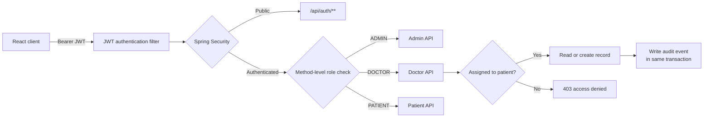
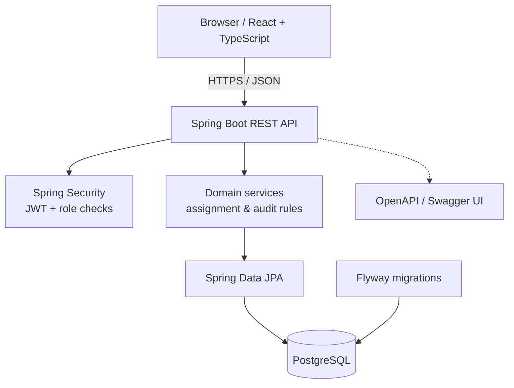
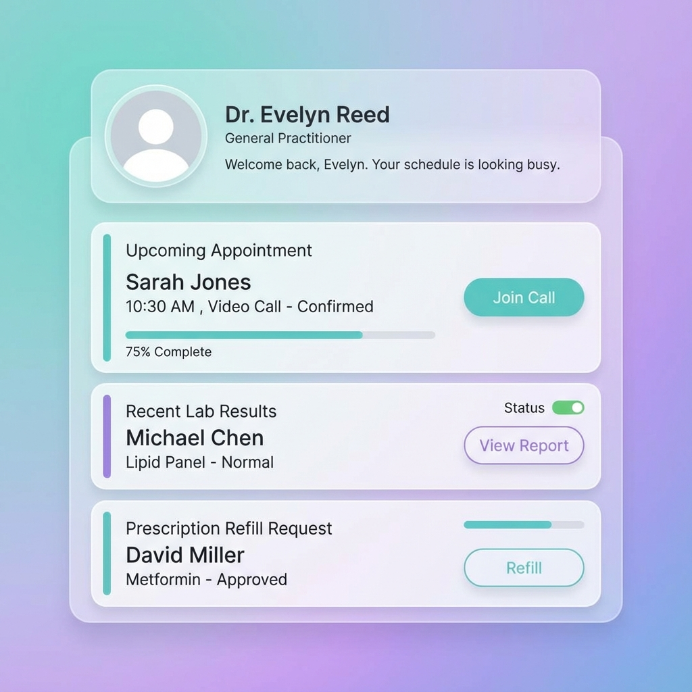
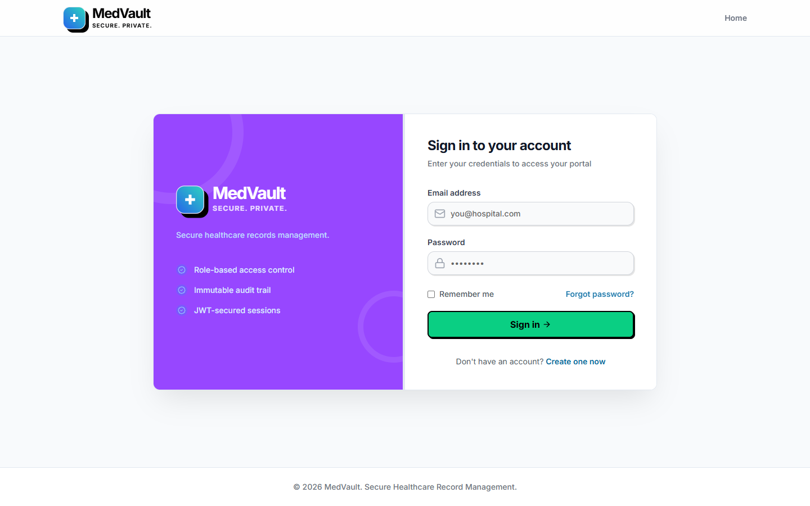
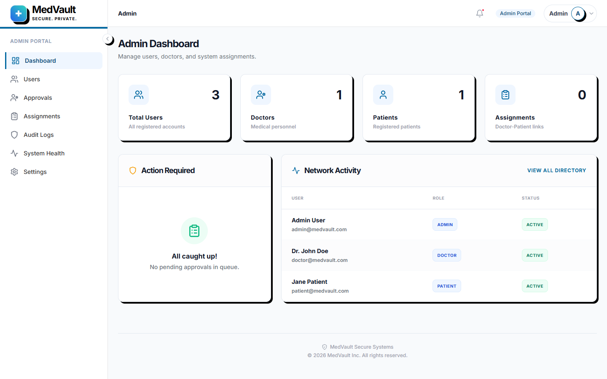
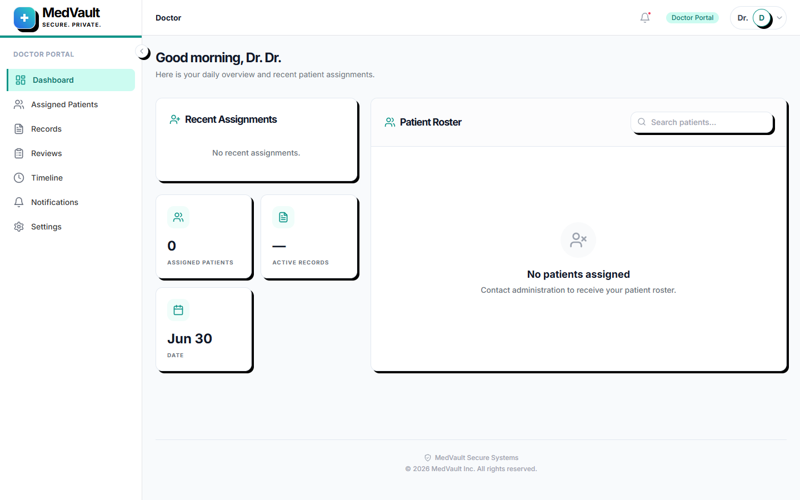
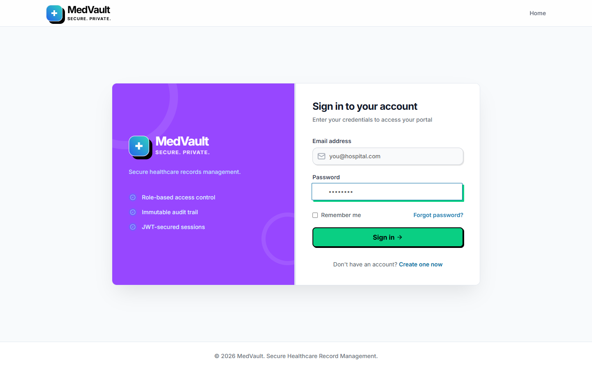
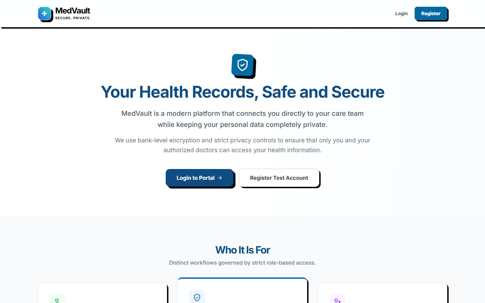

# MedVault

MedVault is a secure, role-based healthcare management system for coordinating patients, doctors, medical records, and accountable administrative oversight. It pairs a React interface with a Spring Boot REST API, PostgreSQL persistence, Flyway migrations, and JWT authentication.

## Why MedVault

| Capability | What it provides |
| --- | --- |
| Role-aware workflows | Dedicated Admin, Doctor, and Patient experiences. |
| Authorization in depth | Every protected route requires authentication; role checks and doctor–patient assignment checks protect clinical records. |
| Accountable record creation | Creating a medical record writes an audit event in the same transaction. If the audit write fails, the record creation is rolled back. |
| Operational visibility | Administrators can retrieve a record's audit history from the dashboard or API. |
| Stateless security | JWT bearer authentication, BCrypt password hashing, rate limiting, and no server-side session state. |

## Security, authorization, and audit trail

Security is a core part of the application flow, not just a login screen:



### Authorization model

| Actor | Permitted actions |
| --- | --- |
| **Admin** | Manage users, activate or deactivate doctors, assign doctors to patients, review patient records, and inspect record audit histories. |
| **Doctor** | View assigned patients and read or create records only for patients assigned to that doctor. |
| **Patient** | View only their own records and assigned doctor. |

All routes except `/api/auth/**`, `/api/health`, and `/error` require a valid JWT. Controllers additionally use role checks, and the service layer verifies the doctor–patient assignment before returning or creating a record.

### Audit events

When a doctor creates a record, MedVault stores the action, actor, timestamp, record reference, and a detail snapshot in `audit_log`. The audit entry is written as part of the record-creation transaction, so a record is never successfully created without its corresponding event. Administrators can inspect the trail through the **Audit Logs** screen or `GET /api/admin/records/{recordId}/audit`.

The application exposes no audit-log modification or deletion API. For a production deployment that requires formal immutability guarantees, also restrict database write privileges so the application role may insert audit events but cannot update or delete them, and consider forwarding logs to a separate retention-controlled system.

## Architecture



## Technology

- **Frontend:** React, TypeScript, Vite, Tailwind CSS, React Router, Axios
- **Backend:** Java 17, Spring Boot (Web, Security, Data JPA), SpringDoc OpenAPI, JJWT
- **Data:** PostgreSQL and Flyway
- **Delivery:** Docker, Docker Compose, NGINX, GitHub Actions

## Workflow gallery

These screenshots cover the main user journeys. The workflow-specific views make the role boundaries and audit visibility easy to verify at a glance.

### Dashboard overview



### Secure sign-in



### Administrator oversight and audit access



### Doctor record-management workflow



### Patient record-access workflow



### Public product overview



## API quick start

The API base URL is `http://localhost:8080/api`. Explore the complete, interactive contract at [Swagger UI](http://localhost:8080/swagger-ui/index.html) after starting the backend.

### 1. Authenticate

```bash
curl -X POST http://localhost:8080/api/auth/login \
  -H "Content-Type: application/json" \
  -d '{"email":"doctor@medvault.com","password":"password123"}'
```

The response contains the JWT and the authenticated user's role:

```json
{
  "token": "eyJhbGciOi...",
  "userId": "9b5f7d39-4a09-43ca-a877-d0ddc094d992",
  "role": "DOCTOR",
  "fullName": "Dr. John Doe"
}
```

Send that token on every protected request:

```bash
export MEDVAULT_TOKEN="eyJhbGciOi..."
curl http://localhost:8080/api/doctor/patients \
  -H "Authorization: Bearer $MEDVAULT_TOKEN"
```

### 2. Create a record as an assigned doctor

```bash
curl -X POST "http://localhost:8080/api/doctor/patients/PATIENT_ID/records" \
  -H "Authorization: Bearer $MEDVAULT_TOKEN" \
  -H "Content-Type: application/json" \
  -d '{
    "diagnosis": "Seasonal allergic rhinitis",
    "prescription": "Cetirizine 10 mg once daily as needed",
    "notes": "Review if symptoms persist for two weeks.",
    "recordDate": "2026-07-24"
  }'
```

This request succeeds only for an assigned patient and creates the associated `CREATE` audit event atomically.

### 3. Review the audit trail as an administrator

```bash
curl "http://localhost:8080/api/admin/records/RECORD_ID/audit" \
  -H "Authorization: Bearer $ADMIN_TOKEN"
```

Useful endpoints at a glance:

| Method | Endpoint | Required role | Purpose |
| --- | --- | --- | --- |
| `POST` | `/api/auth/register` | Public | Register a user. |
| `POST` | `/api/auth/login` | Public | Receive a JWT. |
| `GET` | `/api/patient/records` | Patient | List the caller's records. |
| `GET` | `/api/doctor/patients` | Doctor | List assigned patients. |
| `POST` | `/api/doctor/patients/{patientId}/records` | Doctor + assignment | Create an auditable record. |
| `POST` | `/api/admin/assignments` | Admin | Assign a doctor to a patient. |
| `GET` | `/api/admin/records/{recordId}/audit` | Admin | Retrieve a record's audit history. |

## Run locally

### Docker (recommended)

1. Copy `.env.example` to `.env` and replace `JWT_SECRET` with a long, unique secret (Docker Compose auto-loads `.env`).
2. Start the stack:

   ```bash
   docker compose up --build -d
   ```

3. Open the frontend at `http://localhost:3000`; the API runs at `http://localhost:8080`.

### Local development (H2 in-memory, no PostgreSQL needed)

1. Start the backend with the `local` profile (uses an embedded H2 database with seed data):

   ```bash
   cd backend
   mvn spring-boot:run -Dspring-boot.run.profiles=local
   ```

2. Start the frontend in another terminal:

   ```bash
   cd frontend
   npm install
   npm run dev
   ```

3. Open `http://localhost:5173`; the API is proxied through Vite.

### Local development with PostgreSQL

1. Start PostgreSQL and create a `medvault` database.
2. Start the backend (uses the default `dev` profile):

   ```bash
   cd backend
   mvn spring-boot:run
   ```

3. Start the frontend:

   ```bash
   cd frontend
   npm install
   npm run dev
   ```

## Deploy to production

### Vercel (frontend) + Render (backend) + Neon (PostgreSQL)

#### 1. Set up Neon (database)

1. Create a free [Neon](https://neon.tech) project and copy the PostgreSQL connection string.
2. The backend uses Flyway migrations — tables are created automatically on first startup.

#### 2. Deploy the backend on Render

1. Create a new **Web Service** on [Render](https://render.com) and connect your repository.
2. Use the following settings:
   - **Root Directory:** `backend`
   - **Build Command:** `./mvnw clean package -DskipTests`
   - **Start Command:** `java -jar target/*.jar --spring.profiles.active=prod`
3. Add the following environment variables in Render:

   | Variable | Value |
   | --- | --- |
   | `SPRING_PROFILES_ACTIVE` | `prod` |
   | `SPRING_DATASOURCE_URL` | Your Neon connection string (e.g., `jdbc:postgresql://ep-xxx.us-east-2.aws.neon.tech/medvault?sslmode=require`) |
   | `SPRING_DATASOURCE_USERNAME` | Neon database username |
   | `SPRING_DATASOURCE_PASSWORD` | Neon database password |
   | `JWT_SECRET` | A long, random secret key (at least 32 characters) |
   | `JWT_EXPIRATION` | `1800000` (30 minutes) |

#### 3. Deploy the frontend on Vercel

1. Import your repository into [Vercel](https://vercel.com).
2. Vercel auto-detects Vite — no build configuration needed.
3. Add the environment variable:

   | Variable | Value |
   | --- | --- |
   | `VITE_API_BASE_URL` | `https://your-render-backend.onrender.com/api` |

4. Deploy — Vercel's `vercel.json` (included in the project) handles SPA routing automatically.

> **CORS:** The backend is configured to allow requests from any origin (`allowedOriginPatterns("*")`), so your Vercel domain is automatically permitted. For stricter security, update `CorsConfig.java` with a domain whitelist.

## Test

Backend unit and integration tests use an in-memory H2 database:

```bash
cd backend
mvn test
```

## Roadmap

- Email verification and account-recovery flows
- Short-lived access tokens with an HttpOnly refresh-token flow
- Real-time notifications for new assignments and records
- Appointment scheduling and calendar integration
- Secure document and lab-result uploads