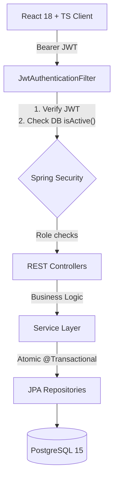
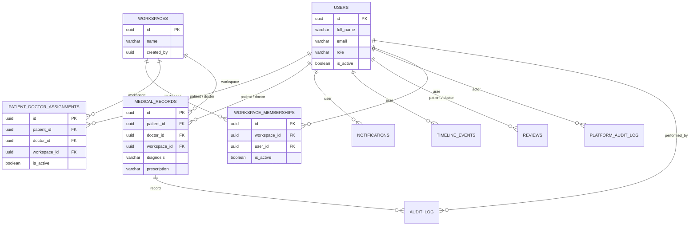

# MedVault

## A. Project Overview
MedVault is a secure, role-based medical-record management system. It enables patients to securely view their clinical records, doctors to manage records for their assigned patients, and administrators to oversee doctor approvals, patient assignments, and system access. MedVault focuses purely on core clinical record management and audit trails; it deliberately excludes scheduling, telemedicine, and billing from its V1 scope.

## B. Key Features
- **Strict Role-Based Access Control**: Distinct portals and capabilities for Admin, Doctor, and Patient workflows, backed by `@PreAuthorize` constraints.
- **JWT Authentication & Status Verification**: Secure authentication issuing short-lived JWTs, with real-time per-request database validation of account status to instantly invalidate deactivated users.
- **Patient Record Ownership & Assignment Authorization**: Patients can solely access their own records. Doctors are restricted to accessing clinical data exclusively for their actively assigned patients.
- **Atomic Clinical Workflows**: Creating a medical record atomically persists the record, generates audit snapshots, dispatches notifications, and appends timeline events in a single transaction.
- **Doctor Reviews**: Patients can submit and update numerical ratings and reviews for their actively assigned doctors.
- **Workspace Management (Backend API Only)**: The backend provides full APIs for workspace and membership management (grouping assignments and records). **However, the workspace management UI is not implemented in the frontend.**

## C. Technology Stack
- **Backend**: Java 21, Spring Boot 3.2.5
- **Security**: Spring Security 6, JJWT 0.11.5
- **Database**: PostgreSQL 15
- **Migrations**: Flyway 10.10.0
- **Testing**: JUnit 5, MockMvc (Backend only)
- **Frontend**: React 18.3, TypeScript 5.4, Vite 7.3, Tailwind CSS 3.4, TanStack React Query 5.90
- **Infrastructure**: Docker, Docker Compose

## D. Architecture
MedVault follows a standard three-tier architecture:
1. **Frontend**: A React/TypeScript SPA communicating via standard REST calls.
2. **REST API & Services**: A Spring Boot backend utilizing controllers to map HTTP requests, secured by a custom JWT filter. The service layer houses business logic and manages transaction boundaries.
3. **Repository & Database**: Spring Data JPA repositories interface with a PostgreSQL database, whose schema is strictly managed by Flyway migrations.



## E. Security and Data Integrity
- **JWT Validation**: `JwtAuthenticationFilter` validates the token signature and synchronously queries the database to verify the user is active, ensuring immediate access revocation upon deactivation.
- **Clinical Data Authorization**: `PatientService` and `DoctorService` enforce IDOR protection by checking patient ownership (`record.getPatient().getId().equals(requesterId)`) and assignment status (`assignmentRepository.existsByPatientAndDoctorAndIsActiveTrue`) before releasing clinical data.
- **Administrative Restrictions**: Administrators are explicitly barred from clinical endpoints. Controllers are decorated with `@PreAuthorize("hasRole('PATIENT')")` or `hasRole('DOCTOR')`, segregating clinical data from administrative sight.
- **Partial Unique Index**: A database-level constraint (`CREATE UNIQUE INDEX idx_assignment_unique_active_patient ... WHERE is_active = true`) ensures a patient has at most one active doctor assignment at any given time.
- **Conflict Handling**: The `GlobalExceptionHandler` intercepts database-level `DataIntegrityViolationException`s (like the assignment constraint above) and returns HTTP 409 Conflict.
- **Transaction Boundaries**: Methods like `createRecord` in `DoctorService` use `@Transactional` to ensure that clinical records, audit logs, notifications, and timeline events are written atomically or rolled back entirely upon failure.

## F. Database Schema and Migrations
The database schema consists of exactly **10 tables**, constructed via **17 sequential Flyway migrations** (`V1` to `V17`) located in `backend/src/main/resources/db/migration/`.

### Entity-Relationship Diagram


## G. API Overview
The REST API exposes precisely **38 distinct HTTP handler methods** across **10 controllers**.

- **Authentication** (`AuthController`): Registration and login endpoints.
- **Administration** (`AdminController`, `WorkspaceController`): Endpoints for approving doctors, assigning patients to doctors, reviewing platform audit logs, and managing workspaces.
- **Doctor Operations** (`DoctorController`): Endpoints for doctors to view assigned patients, read their clinical records, create new records, and view received reviews.
- **Patient Operations** (`PatientController`, `ReviewController`): Endpoints for patients to view their own records, verify their assigned doctor, and submit reviews.
- **Cross-Cutting Concerns** (`NotificationController`, `TimelineEventController`, `UserProfileController`): Endpoints to view and acknowledge notifications, read chronological timelines, and update profiles.

## H. Testing
- **Backend**: The repository contains exactly 47 `@Test` annotated methods in `backend/src/test` covering security, domain rules, and cross-workspace isolation. All 47 tests execute and pass successfully (0 failures, 0 skipped).
- **Frontend**: There are currently no automated tests implemented for the React frontend application.

## I. Prerequisites and Setup
### Requirements
- Docker and Docker Compose
- Java 21 & Maven (for native backend execution)
- Node.js (>=20) & npm (for native frontend execution)

### Option 1: Docker Compose (Recommended)
1. Copy the environment template:
   ```bash
   cp .env.example .env
   ```
2. Build and run the containers:
   ```bash
   docker compose up --build -d
   ```
3. Access the frontend at `http://localhost:3000` and API at `http://localhost:8080`.

### Option 2: Local Development
**Backend**:
```bash
cd backend
./mvnw spring-boot:run
```
*(Alternatively, append `-Dspring-boot.run.profiles=local` to run with an in-memory H2 database, bypassing PostgreSQL requirements).*

**Frontend**:
```bash
cd frontend
npm ci
npm run dev
```
Access the application at `http://localhost:5173`.

> **Note**: In a production-like environment, MedVault starts empty. A `JWT_SECRET` must be generated and provided in the `.env` file, and an initial administrative user must be bootstrapped into the database.

## J. Repository Structure
```text
MedVault/
├── backend/
│   ├── src/main/java/com/medvault/    # Controllers, Services, Repositories, Security
│   ├── src/main/resources/            # Application config, Flyway migrations (db/migration)
│   └── src/test/                      # Backend test suite
├── frontend/
│   └── src/                           # React components, Pages, API clients
├── docs/                              # Project planning, decisions, and audit reports
├── .env.example                       # Environment variables template
├── docker-compose.yml                 # Multi-container orchestration
└── README.md                          # Project documentation
```

## K. Current Limitations
- **Workspace UI**: While the backend fully implements workspace and membership APIs (including cross-workspace authorization checks), **the frontend lacks any workspace management UI or API client integration**. This feature is purely backend-only at this time.
- **Clinical Capabilities**: File uploads, prescriptions routing, and appointments are intentionally excluded.
- **Security**: The application currently issues short-lived access tokens without a refresh token mechanism.